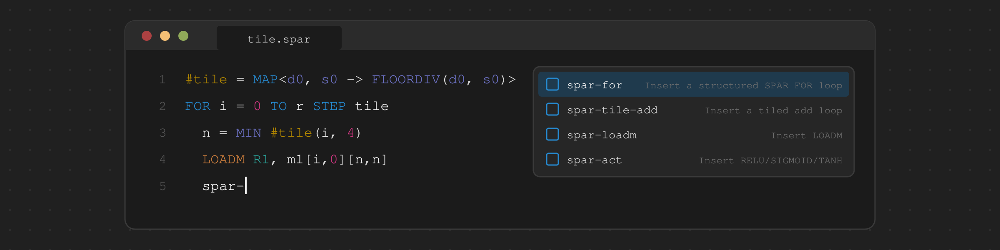

# vscode-spar

Visual Studio Code support for SPAR assembly (`*.spar`), the assembly
language of the [SPAR](https://github.com/SPAR-Public) processor.

* Highlighting of comments, strings, opcodes, tensor types, registers,
  labels, numbers, and operators
* Semantic highlighting, including affine map names (`#tile`) and the
  dimension and symbol identifiers of maps (`d0`, `s0`)
* Snippets for definitions, loops, and common operations
* Comment toggling with `;`, bracket matching, and auto-closing of brackets
  and quotes
* With `spar-asm-lsp-server` installed: diagnostics as you type, hover,
  go to definition, find references, completion, signature help, the
  outline, and links on `#include` paths

For Neovim, see
[tree-sitter-spar](https://github.com/tkamucheka/tree-sitter-spar).

## Installation

Requirements: VS Code 1.90 or later, and Node.js to build the extension
package:

```
git clone https://github.com/tkamucheka/vscode-spar.git
cd vscode-spar
npm run package:vsix
code --install-extension spar-assembly-0.1.0.vsix
```

## Language Server

The language features come from `spar-asm-lsp-server`, built with the
[SPAR toolchain](https://github.com/SPAR-Public) (`cmake --build <build>
--target spar-asm-lsp-server`). The extension starts it when a `.spar` file
is opened; without it, highlighting and snippets still work.

| Setting | Default | |
|---------|---------|---|
| `spar.server.enabled` | `true` | Run the language server |
| `spar.server.path` | `spar-asm-lsp-server` | Executable; a bare name is looked up on `PATH`, `~` and `${workspaceFolder}` are expanded |
| `spar.server.args` | `[]` | Extra arguments, e.g. `["-log=verbose"]` |
| `spar.trace.server` | `off` | Trace protocol messages in the *SPAR Language Server* output |

**SPAR: Restart Language Server** restarts it, e.g. after rebuilding; changing
a `spar.server` setting restarts it automatically. The server analyses saved
files only, since includes resolve relative to the file's directory.

## Snippets

| Prefix | Inserts |
|--------|---------|
| `spar-matrix` | A matrix definition |
| `spar-vector` | A vector definition |
| `spar-for` | A `FOR ... TO ... STEP ... END` loop |
| `spar-tile-add` | A tiled loop that adds two matrices |
| `spar-loadm` | `LOADM` |
| `spar-storem` | `STOREM` |
| `spar-binop` | An `ADD`, `SUB`, or `MULT` operation |
| `spar-act` | A `RELU`, `SIGMOID`, or `TANH` operation |

## Development

```
npm install     # the language client
npm run check   # check the scripts and validate the JSON files
```

With this repository open in VS Code, **Run > Start Debugging** (F5) starts
an Extension Development Host with the extension loaded.
`test/golden_highlighting.spar` is a sample for checking highlighting; the
command **Developer: Inspect Editor Tokens and Scopes** shows the scopes and
semantic tokens assigned to each token.

## License

MIT; see [LICENSE](LICENSE).
